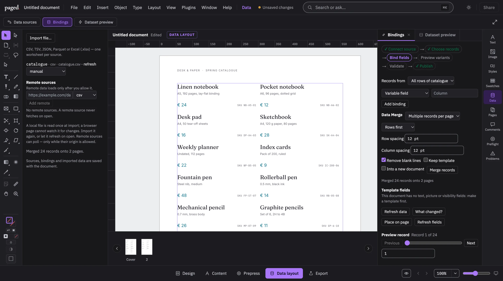

<p align="center">
  <a href="https://paged.media">
    <picture>
      <source media="(prefers-color-scheme: dark)" srcset="docs/assets/readme/paged-wordmark-dark.png">
      
    </picture>
  </a>
</p>

<p align="center"><strong>Open-source publishing software</strong></p>

<h1 align="center">Design the first edition. Automate the next.</h1>

<p align="center">
  Paged is an open-source platform for professional page layout, connected content and automated
  publishing. It brings browser-based design, a programmable document engine and embeddable editing
  into one system, with commercial licensing available for enterprise use.
</p>

<p align="center">
  <a href="https://paged.media/product/"><strong>See the platform</strong></a>
  &nbsp;·&nbsp;
  <a href="https://paged.media/enterprise/#assessment"><strong>Request a workflow review</strong></a>
  <br>
  <a href="https://play.paged.media">Explore the editor</a>
  &nbsp;·&nbsp;
  <a href="https://docs.paged.media">Read the technical documentation</a>
  &nbsp;·&nbsp;
  <a href="https://paged.media">paged.media</a>
</p>

<p align="center">
  
</p>
<p align="center">
  <sub>One product list, one template, 24 catalogue cards on two pages. The template's fields are bound to the
  list's columns, and every name and price stays editable on the page.</sub>
</p>

---

## Professional publishing, beyond the desktop

Desktop publishing ties every edition to one workstation and to the hands that rebuild it. Prices change
after the pages are made, a catalogue is copied page by page, a report is set again every quarter.

Paged keeps the layout as a reusable template connected to its content, so the next edition is produced,
not redrawn. The same document opens in a browser editor, runs in a script and can sit inside another
product:

- **Precise, browser-based design:** paragraph and character styles, master pages, stories threaded
  from frame to frame, pictures cropped in their frames, colour and preflight, export to PDF and PDF/X-4.
- **Structured content connected to pages:** a product list or a spreadsheet bound to a template, every
  record merged onto pages, tables and charts that follow their workbook.
- **A programmable engine for repeatable production:** script the changes a designer would make, then
  render and export from the command line, with no desktop session.
- **An editor you can embed:** give your customers professional document editing inside your own product.
- **Open documents:** Paged reads and writes IDML, the exchange format of Adobe InDesign, so work moves
  between the two.

## Who it is for

| You are                                | With Paged you                                                                       | Start here                                                       |
| -------------------------------------- | ------------------------------------------------------------------------------------ | ---------------------------------------------------------------- |
| A design team                          | set magazines, books and brochures with real styles, in the browser                  | [Editorial layout](https://paged.media/designers/)               |
| Publishing operations                  | produce catalogues and price lists from your product data                            | [Catalogue production](https://paged.media/database-publishing/) |
| Production engineering                 | render, update and export publications from templates and data, on your own machines | [Automated production](https://paged.media/indesign-server/)     |
| Coming from InDesign                   | open IDML exported from InDesign, edit it and save IDML back                         | [Coming from InDesign](https://paged.media/indesign/)            |
| A software vendor                      | give your customers page layout where they already work                              | [Embeddable editor](https://paged.media/embeddable-editor/)      |
| Evaluating Paged for your organisation | review a representative workflow, then run a scoped pilot                            | [Paged for enterprise](https://paged.media/enterprise/)          |

## Open source changes who controls publishing

Paged is developed in public under the GNU Affero General Public License v3.0. Your publications stay in
an open, inspectable format, the engine that composes them is here to read, and you decide where it runs.

Commercial licensing is available for organisations that need different terms for proprietary embedding,
deployment or distribution. Open source does not mean free implementation, support or a hosted service:
those are part of a commercial engagement. Write to [info@paged.media](mailto:info@paged.media) or
[request a workflow review](https://paged.media/enterprise/#assessment).

## Try it

**In the browser.** [play.paged.media](https://play.paged.media) opens the editor. It runs in a recent
desktop browser and draws with WebGPU where the browser has it, otherwise on the CPU at a lower
resolution. On a phone, the [studio](https://paged.media/studio/) shows it at work.

**From the command line.** The engine and the `paged` command are published on npm:

```sh
npx -y -p @paged-media/paged paged export brochure.idml -o brochure.pdf
npx -y -p @paged-media/paged paged --help    # get, set, query, merge, run a script, export, …
```

The export names any font it had to substitute. To build a catalogue step by step, follow
[how to make a catalogue from CSV or Excel](https://paged.media/journal/how-to-make-a-catalogue-from-csv-or-excel/).

## How it works

One document model, one engine, several ways to run it.

- **The engine** ([`engine/core`](./engine/core)) is written in Rust and compiled to WebAssembly. It
  reads IDML, composes text a paragraph at a time, lays out the pages and draws them with WebGPU or on
  the CPU, and it writes PDF, IDML and `.paged`, Paged's own IDML-based document package.
- **The editor** ([`apps/editor`](./apps/editor)) is a React application that runs the engine in a web
  worker. Every change, from a click, a panel or a script, is the same undoable operation.
- **Built-in modules** ([`modules/`](./modules)) add pictures, vector drawing, spreadsheets, data
  publishing, Word, PowerPoint, HTML and PDF.
- **Extensions** build on the public [plugin SDK](https://docs.paged.media/plugin-sdk/).
- **Automation** runs the same engine from Node: the [`paged` command line](https://docs.paged.media/cli/)
  and scripts against `paged.*`.

Published on npm: [`@paged-media/paged`](https://www.npmjs.com/package/@paged-media/paged) (the engine
and the `paged` command), [`@paged-media/viewer`](https://www.npmjs.com/package/@paged-media/viewer)
(a read-only renderer) and [`@paged-media/plugin-sdk`](https://www.npmjs.com/package/@paged-media/plugin-sdk)
(for extensions). The embeddable editor, `@paged-media/editor`, is in this repository and not yet on npm.

## What works today

Paged is in active development, and it says precisely how far each part has come. The
[capability record](https://docs.paged.media/state/) lists every capability with what it rests on and the
tests that check it, from stable to planned. A few boundaries worth knowing before an evaluation:

- Paged opens IDML, not InDesign's `.indd` files: save as IDML from InDesign first. The
  [IDML reference](https://idml.paged.media/) shows what crosses and what does not.
- Data publishing reads files: CSV, TSV, Excel, JSON and Parquet. Connections to databases and PIM
  systems are not built.
- The full editor is made for desktop screens; on a phone, the fill-in forms and templates work.
- The npm packages follow the tagged releases, which can be behind this repository's main branch.

## The repository

Everything is here at one revision. Each directory has its own README, docs and build instructions.

| Path                  | What it is                                                                                                                     |
| --------------------- | ------------------------------------------------------------------------------------------------------------------------------ |
| `engine/core`         | The engine: IDML import and export, text composition, layout, rendering with WebGPU and on the CPU, PDF. Rust and WebAssembly  |
| `apps/editor`         | The editor, and the embedding API behind `@paged-media/editor`                                                                 |
| `apps/cli`            | The `paged` command line for Node, published inside `@paged-media/paged`                                                       |
| `apps/server`         | `paged.server`, an optional server for documents kept as versions and releases                                                 |
| `modules/*`           | Built-in modules: `image`, `draw`, `sheet`, `data`, `doc` (Word), `slide` (PowerPoint), `web` (HTML), `publish` (IDML and PDF) |
| `platform/extensions` | The extension contract and the public plugin SDK                                                                               |
| `packages/paged`      | The npm package `@paged-media/paged`                                                                                           |
| `docs/`               | Decisions that span the repository (`docs/adr`) and development guides                                                         |
| `tooling/`            | Build and repository tooling                                                                                                   |

## Build from source

Tool versions are pinned: install [proto](https://moonrepo.dev/proto) for Bun, Moon and Node, and
[rustup](https://rustup.rs) for the Rust toolchains each workspace names.

```sh
proto install                       # Bun, Moon and Node at the pinned versions
tooling/bootstrap.sh --check        # wasm-bindgen and binaryen at the versions the engine needs
bun install --frozen-lockfile       # every JavaScript package, once, at the root
moon run core:wasm-pkg doc:wasm slide:wasm sheet:wasm data:wasm web:wasm   # the engine and module wasm
cd apps/editor/apps/canvas && bun run dev    # the editor at http://localhost:5173
```

`moon run <project>:test` runs a component's tests, and `moon ci --base origin/main --head HEAD` runs
what a branch affects. [`CONTRIBUTING.md`](./CONTRIBUTING.md) has the rest.

## Contributing

Issues and pull requests are welcome. Contributions are accepted under the
[Contributor License Agreement](./CLA.md), which lets And The Next GmbH distribute them under both
licences; you keep the copyright to your work. Please report security issues privately to
[info@paged.media](mailto:info@paged.media), not in a public issue.

## Licence

Paged is dual-licensed: `AGPL-3.0-only OR LicenseRef-PMEL`. Use it under the
[GNU Affero General Public License v3.0](./LICENSE), or under the Paged Media Enterprise License, a
commercial licence from And The Next GmbH. Versions published before the move to the AGPL remain
available under the terms they were published with. See [`LICENSE.md`](./LICENSE.md).

`paged`, `paged.media` and the Paged logo are trademarks of And The Next GmbH.
